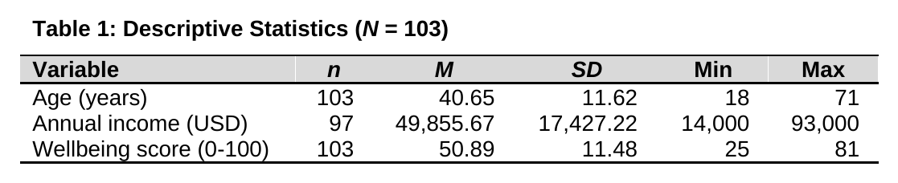
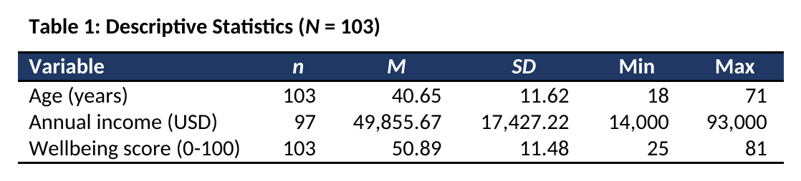

```{r}
#| label: obx-setup
#| include: false

# ---------------------------------------------------------------------------
# CONSOLE FACSIMILES -- render scaffolding, hidden (include: false). Same
# mechanism as anova.qmd: pane_facsimile.R defines the capture-once /
# display-twice helpers in their own dot-named environment (.obx). Each block
# below is one call whose code STRING is both printed into the page and
# executed once, so the shown code and the run code cannot drift. An
# unexpected error in any block HALTS the render (the publish gate); block 8's
# error is deliberate and is named with expect_error_match.
#
# Devices, by the OUTPUT-REGISTER rule: the prose and the "Reading this output"
# boxes READ the output of blocks 1-4 and 7-9, so those panes render OPEN
# (.obx$show_console(fence = TRUE)). Block 6's printout is some 200 lines, the
# reader's own result to check: a collapsed "What you should see" box
# (.obx$show_block()). Block 5 is comments only (the step happens in the
# reader's AI assistant), so it is a plain fence.
#
# THE ASSISTANT'S REPLY. A render cannot ask an AI assistant, so the hidden
# chunk "assistant-reply" (after block 5) makes, in styles/myblue.jstyle, the
# four changes the page's example request asks for, as the assistants in the
# S417-S418 test made them; the page says so in its prose.
#
# jstats is NOT pre-loaded: block 1 teaches library(jstats), and R prints the
# startup message on first attach only. joutput()/joptions() are left alone. The
# page WRITES files into the working directory (a styles folder, two Word files,
# myblue.txt); the clean-slate lines below clear them before the blocks run (a
# halted render never reaches the teardown chunk at the foot), and the teardown
# clears them after. Only the Publication tables pages' files are removed (the
# shared list below); the styles folder goes only when it is left empty.
#
# YOUR OWN TABLE STYLES, PAGE 4 (S422 review; was Publication tables page 8; drafted S421 as ai-styles.qmd). It STANDS
# ALONE: readers may arrive by the AI route without pages 1-7, so it repeats
# the table, the copy and the check (Authoring Conventions, [HOW-TO-LAYOUT],
# TOPICS AND ORDER). Matching an example moved to page 10; where to keep
# styles to page 6.
#
# HOW-TO LAYOUT (S344). No top boxes: the shared material lives once on
# howtos.qmd, and this page points there.
#
# S428 (the S427 wording pass, Fable 5.2, okayed by Jeff): the recurring
# changes A-M and L and the page's 42 numbered changes; the request text in
# block 5 is the S417-S418 test's prompt, left as it was.
# ---------------------------------------------------------------------------

options(width = 80)   # match a default 80-column console for table alignment
options(jstats.attach.noninteractive = TRUE)   # let block 1 show the real startup message

# THE SHARED LIST (S422): every Publication tables page's files, so a render
# halted on one page cannot leave a style file in the styles folder another
# page creates and lists. A styles folder still holding anything else HALTS
# the render: it is not this page's to remove.
.tables_files <- c("styles/myreport.jstyle", "styles/mystyle.jstyle",
                   "styles/myblue.jstyle", "styles/mytest.txt",
                   "styles/mytest.jstyle", "styles/mymatch.jstyle",
                   "myblue.txt", "mymatch.txt", "Descriptives.docx",
                   "Regression.docx", "Report.docx", "Report_report.docx",
                   "Table1_mystyle.docx", "Table1_report.docx",
                   "Table1_myblue.docx", "Tables_mymatch.docx",
                   "Models.docx")
.ai_clean <- function() {
  f <- .tables_files[file.exists(.tables_files)]
  if (length(f)) file.remove(f)
  if (dir.exists("styles") &&
      !length(list.files("styles", all.files = TRUE, no.. = TRUE)))
    unlink("styles", recursive = TRUE)
  invisible(NULL)
}
.ai_clean()
if (dir.exists("styles"))
  stop("The project's styles folder holds files no Publication tables page ",
       "wrote. Move them out and render again.", call. = FALSE)

source("pane_facsimile.R")   # defines .obx (dot-named); turns the output color on
```

## Changing a style with an AI assistant

**Your own table styles &middot; Page 4**\
*Pages 3 to 5 show three ways to change a style: pick one. This page stands on
its own: it repeats what it needs from the pages before it, so you can start
here.*

This page is a hands-on run-through of changing how your tables look in Word by
asking an AI assistant, such as Microsoft Copilot, ChatGPT, Gemini, or Claude, in
plain words: "use Calibri 11 and a dark blue header row". You make a copy of a
jstats *style*, hand it to the assistant with your request, and check what comes
back before you use it. On page 3,
[Changing a style by hand](tables-by-hand.qmd), you make the same kind of
change yourself, in RStudio.

A style is the set of choices that decide how every table looks when `jtable()`
writes it to Word: the font and its size, the shading of the header row, which
lines are drawn, how the title and the notes are laid out, how many decimal
places a statistic gets, and many more. jstats has two built-in styles. `apa`
follows APA 7 (the American Psychological Association's style), for journal
manuscripts, and is the default. `report` is the plain look shared by the style
manuals that agencies and institutes write for their reports. A copy of either
can be saved as a *style file*, a plain-text file listing every setting with a
note on what each does. The copy is what the assistant changes. If you've
worked through the Publication tables pages and pages 1 to 3 of this topic, the
first three blocks will look familiar.

This page follows the pattern of every How-To: numbered blocks of code that
build one script, with the finished script to download at the bottom.
[Using the How-To pages](howtos.qmd#using-the-how-to-pages) explains the
pattern, and how to reset your session if something goes wrong.

### 1. Load jstats and the data

We'll work on `community`, one of the two practice datasets that ship with the
package: 103 simulated respondents to a community survey. `jload()` puts a copy
of it in your workspace, and `juse()` makes `community` the default data frame,
so the commands that follow can leave its name out.

```{r}
#| echo: false
#| results: asis
.obx$show_console(r"---(## ---- 1. Load jstats and the data --------------------------------------

## Load jstats and the community practice dataset, and make community the
## default data frame. quiet = TRUE skips jload()'s report on what it
## loaded; overwrite = TRUE replaces a copy already loaded in this session
## without asking first
library(jstats)
jload("community", overwrite = TRUE, quiet = TRUE)
juse(community))---", fence = TRUE,
  lead = "The command lines are shown; the standalone <code>##</code> comment lines aren't -- running a comment just echoes it back and does nothing.")
```

### 2. Make a table in the report style

A table starts from a result saved with `<-`, the assignment operator. Here the
result is `jdesc()`'s descriptive statistics for three variables.
`print = FALSE` keeps `jdesc()`'s own output out of the Console, since the Word
table is what we're after. (In R, to *print* a result is to show it in the
Console. Nothing goes to a printer or to Word.) `jtable()` then makes the table
in a style, here `report`, and writes it to a Word file in your working
directory (your project's folder).

```{r}
#| echo: false
#| results: asis
.obx$show_console(r"---(## ---- 2. Make a table in the report style ------------------------------

## Save a result, then make a table from it in the built-in report style
## and write the table to a Word file. open = TRUE opens the file once it
## is written
d1 <- jdesc(Age, Income, WellbeingScore, print = FALSE)
t1 <- jtable(d1, style = "report", file = "Table1_report.docx", open = TRUE)

## print() is base R: it shows an object in the Console, here the table
print(t1)  # base R)---", fence = TRUE)
```

`jtable()` reports what it made (Table 1, with three variables, on a portrait
page) and where it wrote the Word file. On your screen that line gives your own
working directory, which this page shows as `~/your-working-directory`.
`print(t1)` shows the same table in the Console.

::: {.callout-note collapse="true" title="Reading this output"}
- **The first three lines** are `jtable()`'s summary of what it did: the
  table's number and title; what the table holds, and the kind of page it goes
  on in the Word file (portrait here); and where the file was written.
  `jtable()` shows this short summary rather than the table itself, so that one
  call writing several tables doesn't fill the Console.
- **`print(t1)`** shows the table laid out as the Word table is: the caption
  (`report` puts "Table 1:" and the title on one line), the column headings,
  the rows, and rows of dashes where the Word table has lines. The row labels,
  such as "Age (years)", are the variables' labels from the dataset.
- **What the Console can't show** is the look: a font, a size, a shading color.
  `print()` shows the layout, and the Word file is where you judge the look.
  That matters for this page, because most requests you'll give an assistant
  change the look.
:::

{width=560px fig-alt="A descriptive statistics table in Word in the report style: the caption 'Table 1: Descriptive Statistics (N = 103)' in bold, a light gray header row, three variable rows."}

### 3. A folder for your styles, and a copy of report

jstats looks for a style file in a *style folder*, if you've set one, then in
your working directory, then in your *jstats folder*, a folder jstats keeps for
you. For
this page, the style folder is a folder named `styles` inside your project. A
style you mean to keep belongs somewhere safer: page 2,
[Keeping your styles](tables-keeping-styles.qmd), says where.

`jstyle()` with `save.as =` writes a copy of a style into the style folder.

```{r}
#| echo: false
#| results: asis
.obx$show_console(r"---(## ---- 3. A folder for your styles, and a copy of report ----------------

## Keep this page's styles in a styles folder inside the project. jstats
## makes the folder; the setting lasts until R restarts
joptions(style.dir = "styles")

## Save a complete copy of report as myblue, every setting written out
## with a note. Run this line once: run again, it asks before replacing
## myblue.jstyle, and n (no) keeps the changes your assistant made
jstyle("report", save.as = "myblue", open = TRUE))---", fence = TRUE)
```

```{r}
#| label: head-lines
#| include: false
# The style file's head, quoted below from the file block 3 wrote, so the
# quotation cannot drift from what the package writes.
.head <- readLines("styles/myblue.jstyle", encoding = "UTF-8")
.ai_from <- grep("^# To an AI assistant", .head)
.ai_to   <- grep("^# Then say what the request asks for", .head)
stopifnot(length(.ai_from) == 1L, length(.ai_to) == 1L, .ai_to > .ai_from,
          .ai_to - .ai_from <= 8L)
.n_lines <- length(.head)
```

jstats made the `styles` folder and wrote the copy, `myblue.jstyle`, into it.
With `open = TRUE` the file opens in a tab beside your script. It is plain text,
about `r format(round(.n_lines, -2))` lines: every setting jstats has, each
after a note saying what it does and what values it takes. Near the top are
instructions written for an AI assistant:

```{r}
#| echo: false
#| results: asis
cat("```text\n", paste(.head[.ai_from:.ai_to], collapse = "\n"), "\n```\n", sep = "")
```

Those lines name the file to send back, `myblue.jstyle`: jstats writes the
copy's own name into them. (The name `myblue` is for the dark blue header row
this page asks for.) Give an assistant a *complete* copy like this one, made by
a `jstyle()` line with `save.as =` and no settings after it. `jstyle()` can also
write a short file that holds a few settings and takes the rest from the style
it is based on, but an assistant given a short file can't see the settings the
file leaves out.

::: {.callout-note collapse="true" title="Reading this output"}
The first three lines are `joptions()` confirming the setting it changed. The
next two say that jstats created the folder, and where it wrote the file. On
your screen the file's path starts with your own working directory.
:::

::: {.callout-note collapse="true" title="Going deeper (optional)"}
Open `myblue.jstyle` and scroll down. The general settings come first: the
font, the size, the caption, the header row, the rules (a table's horizontal
lines), the notes, the decimals. Then each kind of table has a section of its
own, under its name in square brackets: `[descriptives]`, `[frequencies]`,
`[regression]`, and the rest, with the settings for that kind of table only, such as which columns a
regression table shows. `[plot]` comes last, for charts. The help page
`?jstyle_settings` lists every setting and what it takes. The books cover every
setting in depth, and designing a house style, with worked examples.
:::

### 4. A copy to upload

An assistant's upload box takes a file whose name ends in `.txt`, and some,
Microsoft Copilot among them, refuse one ending in `.jstyle`. So make a copy
with the ending `.txt` for the upload. The copy goes in your working directory,
outside the style folder, which should hold only `.jstyle` files.

```{r}
#| echo: false
#| results: asis
.obx$show_console(r"---(## ---- 4. A copy to upload ----------------------------------------------

## file.copy() is base R: it copies a file. overwrite = TRUE replaces an
## older copy, so run this line again before each upload
file.copy("styles/myblue.jstyle", "myblue.txt", overwrite = TRUE)  # base R)---",
  fence = TRUE)
```

`TRUE` means the copy was made. `myblue.txt` is only for uploading: jstats
doesn't use it as a style. Each time you send the style to the assistant again
for more changes, run the line again first, so the upload holds the latest
version.

### 5. Ask your assistant (outside R)

This step happens in your AI assistant, not in R. The block below is only
comments, a note in your script of what you did.

```r
## ---- 5. Ask your assistant (outside R) --------------------------------

## Upload myblue.txt with the request on the guide page, and save the file
## that comes back as myblue.jstyle in the styles folder, replacing the
## copy there
```

Open a new chat in your assistant, attach `myblue.txt`, and send this message,
with your own request in place of the example in the middle:

```text
Attached is myblue.txt, a jstats table style whose notes say what each
setting does and what it takes. Change it as follows, following the
instructions at the top of the file: use Calibri 11 and a dark blue header
row with white text. Give me the changed file as a download named
myblue.jstyle. Then list each value you changed, old and new, and anything
the settings cannot do.
```

Then:

1. **Download the file the assistant gives you**, and move it into the
   `styles` folder of your project, replacing the `myblue.jstyle` there. To
   find the folder outside RStudio, click **More** (the gear) in the **Files**
   tab of the lower-right pane, then **Show Folder in New Window**.
2. **Check the name in RStudio's Files tab.** Open the `styles` folder there:
   it should hold `myblue.jstyle`, and no `myblue.txt` or
   `myblue.jstyle.txt`. The Files tab always shows a file's whole name, while
   Windows' File Explorer hides the endings it knows, so `myblue.jstyle.txt`
   can look like `myblue.jstyle` there.
3. **Keep the assistant's reply.** Its list of what changed is what you check
   the file against in block 6.

Some assistants can't make a file to download. The instructions at the top of
the style file tell an assistant in that case to give the whole text for you to
save.
Copy that text, open `myblue.jstyle` in RStudio (click it in the Files tab),
select everything in it, paste the assistant's text over it, and save. The name
stays as it was. An assistant that takes no upload at all can be given the text
instead: open `myblue.txt`, copy all of it, and paste it into your message in
place of the attachment. The file is long, so check that the reply gives back
the whole file.

This route was tested with Microsoft Copilot and with Claude, given the same
set of requests: every file that came back read cleanly in jstats, with no
setting added, lost, or invented. Other assistants that take a file upload
should work the same way, but haven't been tried yet.

```{r}
#| label: assistant-reply
#| include: false
# THE ASSISTANT'S REPLY, made here because a render cannot ask an assistant:
# the four changes the example request asks for, as the assistants in the
# S417-S418 test made them (T1 font and size; T2 the header's fill and text).
.rp <- readLines("styles/myblue.jstyle", encoding = "UTF-8")
.set1 <- function(x, from, to) {
  i <- which(x == from)
  stopifnot(length(i) >= 1L)
  x[i[1]] <- to   # the general setting: the first line of its name
  x
}
.rp <- .set1(.rp, "font = Arial", "font = Calibri")
.rp <- .set1(.rp, "size = 10", "size = 11")
.rp <- .set1(.rp, "header.fill = D9D9D9", "header.fill = 1F3864")
.rp <- .set1(.rp, "header.text = 000000", "header.text = FFFFFF")
stopifnot(which(.rp == "font = Calibri") < grep("^\\[descriptives\\]", .rp),
          which(.rp == "size = 11") < grep("^\\[descriptives\\]", .rp))
writeLines(.rp, "styles/myblue.jstyle", useBytes = TRUE)
```

The rest of this page uses a file with the four changes the example asks for,
made as the assistants in the test made them: `font = Calibri`, `size = 11`,
`header.fill = 1F3864` (a dark blue), and `header.text = FFFFFF` (white). Your
assistant may choose a different blue.

### 6. Check what came back

`jstyle()` with a style's name reads the style file and shows every setting in
the Console. If a line holds something jstats can't use, `jstyle()` stops at
that line and names it.

```{r}
#| echo: false
#| results: asis
.obx$show_block(r"---(## ---- 6. Check what came back ------------------------------------------

## jstyle() reads the file and shows every setting. It stops at a line it
## cannot use, and names the line
jstyle("myblue"))---", chrome = TRUE)
```

```{r}
#| label: stop-messages
#| include: false
# The two messages quoted below, built by running jstyle() on two broken
# copies of the file block 6 read, so the quotations are the package's own.
.td <- tempfile("ai-msgs-"); dir.create(.td)
.cp <- readLines("styles/myblue.jstyle", encoding = "UTF-8")
.broken <- function(lines) {
  f <- file.path(.td, "myblue.jstyle"); writeLines(lines, f, useBytes = TRUE); f
}
.err <- function(expr) tryCatch({ expr; NA_character_ },
                                error = function(e) conditionMessage(e))
.e1 <- .err(jstyle(.broken(append(.cp, c("", "note.label.bold = yes"),
                                  after = which(.cp == "note.label.italic = no")[1]))))
.e2 <- .err(jstyle(.broken(replace(.cp, which(.cp == "header.fill = 1F3864")[1],
                                   "header.fill = dark blue"))))
.flat <- function(s) trimws(gsub("\\s+", " ", s))
.msg_inv <- sub("^jstyle\\(\\): ", "", .flat(sub("\nIt may be.*$", "", .e1)))
.msg_val <- sub("^jstyle\\(\\): ", "", .flat(.e2))
stopifnot(grepl("which is not a setting jstats has.", .msg_inv, fixed = TRUE),
          grepl("note.label.bold", .msg_inv, fixed = TRUE),
          grepl("sets header.fill = dark blue.", .msg_val, fixed = TRUE),
          grepl("must be", .msg_val, fixed = TRUE),
          !grepl("`r ", .msg_inv, fixed = TRUE), !grepl("``", .msg_val, fixed = TRUE))
```

`jstyle()` read the file without stopping, and the four changes are at the top
of the settings it lists: `font = Calibri`, `size = 11`, `header.fill = 1F3864`,
and `header.text = FFFFFF`. Check them against the assistant's list of changes,
and check both against what you asked for.

When a line is wrong, `jstyle()` stops and names the line. Two examples:

- A setting jstats doesn't have. The message begins
  `` `r .msg_inv` ``
- A value the setting doesn't take. The message reads
  `` `r .msg_val` ``

Give the message to the assistant, ask it to fix that line, and check the file
again.

::: {.callout-note collapse="true" title="Reading this output"}
- **The top lines** name the style, the file it was read from, and the styles
  it is based on: "based on report, then apa". A setting the file left out
  would come from `report`, and a setting that `report` leaves out would come
  from `apa`. A complete copy leaves out nothing, so the next line says "Set in
  this file: every setting."
- **The settings** follow in the file's order: the general settings first,
  then each kind of table's section under its name in square brackets, then
  `[plot]`, for charts.
- **Two values follow the size.** `caption.size` reads `size`, and `note.size`
  reads `size - 1`, so the caption is now 11 points and the note 10, though
  neither line changed.
- **If the list still shows Arial and 10**, jstats read a different file
  from the one you saved. Look in the `styles` folder for a `myblue.txt` or
  `myblue.jstyle.txt` beside `myblue.jstyle`, and see block 8.
:::

### 7. The table in your style

Now make the same table in the new style. A table keeps the style it was made
in, so the new table is made from the result, `d1`, not from `t1`.

```{r}
#| echo: false
#| results: asis
.obx$show_console(r"---(## ---- 7. The table in your style ---------------------------------------

## Make a table from the same result in the new style, and write it to a
## second Word file
t2 <- jtable(d1, style = "myblue", file = "Table1_myblue.docx", open = TRUE))---",
  fence = TRUE)
```

`jtable()` wrote the table in `myblue` to `Table1_myblue.docx`. Open the two
Word files side by side: the second is in Calibri 11, with a dark blue header
row and white header text. `print(t2)` would show nothing new: in the Console
the two tables are the same, line for line.

{width=560px fig-alt="The same descriptive statistics table in Word in the changed style: Calibri, a dark blue header row with white bold text."}

If the assistant's list names a setting in the `[plot]` section, look at a chart
in the new style as well. `jtable()` writes a chart from `jplot()` to Word as a
figure, in a style, as it writes a table:

```r
p1 <- jplot(Region)
jtable(p1, style = "myblue", file = "Figure1_myblue.docx", open = TRUE)
```

Change the look in the style file and run `jtable()` again, rather than
editing the table in Word: the next run writes over any edits made in Word.

::: {.callout-note collapse="true" title="Why jstats does it this way"}
jstats keeps the look of a table apart from the analysis. The analysis gives
the numbers, and the style decides how they are laid out, so one change to the
style file changes every table made with it, and running the script again
rebuilds every table in the new look. A journal's style or an agency's is one
small file, which you can email to a colleague or copy to a new computer.

The style file is plain text, one setting to a line, each with a note on what
it does and what it takes. That is what lets an AI assistant change one
reliably: the notes say what each value means, and `jstyle()` checks the
result.

Base R has no function that writes a table to a Word file. Add-on packages do,
each with its own syntax, defaults, and output.
:::

### 8. If the file comes back as .txt

An assistant told to return `myblue.jstyle` sometimes returns a `.txt` file
anyway. And on Windows, renaming a file while File Explorer hides its ending
can leave it named `myblue.jstyle.txt`. jstats reads a style only from a file
whose name ends in `.jstyle`. To see what jstats does with a file that ends in
`.txt`, make one on purpose, here named `mytest.txt`.

```{r}
#| echo: false
#| results: asis
.obx$show_console(r"---(## ---- 8. If the file comes back as .txt --------------------------------

## Make a style file that ends in .txt, from the upload copy
file.copy("myblue.txt", "styles/mytest.txt", overwrite = TRUE)  # base R

## jstats reads a style only from a file ending in .jstyle, so this stops
## (on purpose) and gives the line that renames the file
jstyle("mytest"))---", fence = TRUE,
  expect_error_match = "jstats reads a style only from a file")
```

`jstyle()` found no style named `mytest`, but it saw `mytest.txt` in the style
folder, said why the file can't be read, and gave the line that renames it. The
line uses the file's full path, so it works as it appears in your Console: copy
it from there, not from this page.

### 9. Rename it

```{r}
#| echo: false
#| results: asis
.obx$show_console(r"---(## ---- 9. Rename it -----------------------------------------------------

## file.rename() is base R. The line jstyle() gave does the same, with
## the full paths
file.rename("styles/mytest.txt", "styles/mytest.jstyle")  # base R

## The style is found now: jtable() builds the table in it
t3 <- jtable(d1, style = "mytest"))---", fence = TRUE)
```

`TRUE` means the file was renamed, and `jtable()` made the table in `mytest`
without stopping. With no `file =`, `jtable()` writes no Word file, and says so.

## What a style can and can't do

- **One kind of table only.** A general setting, such as the decimals or the
  font, can take a value of its own for one kind of table: the assistant copies
  the setting's line under that table's heading. Ask in words like these:
  "three decimal places in regression tables only". This works for every
  general setting except `paper`, which sets the paper size of the whole Word
  file, and under every heading except `[plot]`.
- **Significance stars.** Ask for stars and the assistant sets
  `p.format = stars`.
  The table then has no *p* column, and the stars go on the statistic itself:
  on *b* in a regression table, and on *t*, *F*, or chi-square.
- **Tables and charts.** The `[plot]` section has a font and a size of its own.
  Asked for "Calibri 11", one assistant in the test changed the charts with the
  tables and another left them alone. Say "for tables and charts", or "for
  tables only".
- **Looks no setting makes.** Some looks can't be made with the settings, such
  as a bold "Note:" label, or a line under each variable's rows. The
  instructions in the file tell the assistant to say so rather than invent a
  setting, and if one slips in anyway, `jstyle()` stops at it.

## Where to go next

- **Matching a published table.** Instead of describing a look, you can show
  your assistant an example: page 6,
  [Matching the look of a published table](tables-matching.qmd), uses this
  page's route with an example attached.
- **Keeping your styles.** The `styles` folder this page used is inside the
  project, so it is deleted when the project is. Page 2,
  [Keeping your styles](tables-keeping-styles.qmd), says where to keep a
  style you mean to keep, and how every project can find it.

```{r}
#| label: prose-gates
#| include: false

# ---------------------------------------------------------------------------
# PROSE GATES -- hidden. Each stopifnot() below is one statement the prose
# makes about what the package does; a false one HALTS the render, the same
# publish gate the blocks have. Each gate compares two runs that differ in the
# one thing the prose claims, so it can fail.
# ---------------------------------------------------------------------------
.q <- function(expr) {            # run quietly; keep what was printed
  out <- utils::capture.output(res <- suppressMessages(expr))
  attr(res, "printed") <- out
  res
}
.pr  <- function(x) utils::capture.output(print(x))
.cp  <- readLines("styles/myblue.jstyle", encoding = "UTF-8")
.var <- function(lines, extra, after) {      # a variant of the style, by path
  f <- tempfile("ai-var-", tmpdir = .td, fileext = ".jstyle")
  writeLines(append(lines, extra, after = after), f, useBytes = TRUE); f
}
.chk <- attr(.q(jstyle("myblue")), "printed")

# block 7: a chart as a figure, in the style (the static fence), drawn on a
# null device so the render writes no stray figure file
grDevices::pdf(NULL)
.p1 <- suppressMessages(jplot(Region))
.fig <- .q(jtable(.p1, style = "myblue", file = file.path(.td, "Figure1_myblue.docx")))
invisible(grDevices::dev.off())

# "One kind of table only": decimals = 3 under [regression] changes a
# regression table and leaves a descriptives table as it was
.reg3 <- .var(.cp, "decimals = 3", which(.cp == "[regression]"))
.m1   <- jlm(WellbeingScore ~ Age, print = FALSE)
.reg_a <- .pr(jtable(.m1, style = "myblue", print = FALSE))
.reg_b <- .pr(jtable(.m1, style = .reg3, print = FALSE))
.des_a <- .pr(jtable(d1, style = "myblue", print = FALSE))
.des_b <- .pr(jtable(d1, style = .reg3, print = FALSE))
# ... and paper under a heading stops
.ppr  <- .var(.cp, "paper = letter", which(.cp == "[regression]"))
.e3   <- .err(jstyle(.ppr))

# "Significance stars": p.format = stars, no p column, the stars on t
.st_f <- .cp; .st_f[which(.cp == "p.format = exact")[1]] <- "p.format = stars"
.stars <- .var(.st_f, character(0), 0L)
.tt   <- jt(WellbeingScore ~ Volunteer, print = FALSE)
.tt_a <- .pr(jtable(.tt, style = "myblue", print = FALSE))
.tt_b <- .pr(jtable(.tt, style = .stars, print = FALSE))
.head_row <- function(x) x[grep("^Variable", x)]
.data_row <- function(x) x[grep("^Wellbeing", x)]

stopifnot(
  # block 2: the Word file written
  file.exists("Table1_report.docx"),
  # block 3: a complete copy, its head naming the file to return
  .n_lines > 700, .n_lines < 900,
  any(grepl("return the whole file, named myblue.jstyle (not .txt).", .head, fixed = TRUE)),
  any(grepl("give the whole text for the user to save as myblue.jstyle.", .head, fixed = TRUE)),
  # block 6: the printout's top lines and the four values
  any(grepl("based on report, then apa", .chk, fixed = TRUE)),
  any(grepl("Set in this file: every setting.", .chk, fixed = TRUE)),
  any(grepl("^font += Calibri$", .chk)), any(grepl("^size += 11$", .chk)),
  any(grepl("^header.fill += 1F3864$", .chk)), any(grepl("^header.text += FFFFFF$", .chk)),
  any(grepl("^caption.size += size$", .chk)), any(grepl("^note.size += size - 1$", .chk)),
  # block 7: written, and the same preview line for line
  file.exists("Table1_myblue.docx"), identical(.pr(t1), .pr(t2)),
  # block 7: a chart as a figure in the style
  file.exists(file.path(.td, "Figure1_myblue.docx")),
  # block 9: renamed, and found
  file.exists("styles/mytest.jstyle"), !file.exists("styles/mytest.txt"),
  # one kind of table: the regression table changes, descriptives do not
  !identical(.reg_a, .reg_b), identical(.des_a, .des_b),
  # paper under a heading stops
  !is.na(.e3),
  # stars: a p column before, none after, and a star on the t value
  grepl("\\bp\\b", .head_row(.tt_a)), !grepl("\\bp\\b", .head_row(.tt_b)),
  !grepl("\\*", .data_row(.tt_a)), grepl("-3\\.34\\*", .data_row(.tt_b))
)
unlink(.td, recursive = TRUE)
```

## Take the whole script with you

That's the full run-through. If you'd like the entire script in one file to
keep and reuse, download it here. Put your own result in place of `d1`, and
your own style's name in place of `myblue`.

The file is the finished version of the script you built: the same code, in the
same order, with one difference made on purpose. The line in block 8 that
raises the deliberate error is commented out, with a note saying why, so the
file runs from top to bottom without stopping. Block 5 is still only comments:
the assistant's part happens outside R.
[Using the How-To pages](howtos.qmd#using-the-how-to-pages) says more about
finished scripts and how to run one.

<div style="margin: 1rem 0 2rem;">
<a href="tables-ai-assistant-follow-along.R" download class="btn btn-primary">Download the full script (.R)</a>
</div>

```{r}
#| label: obx-teardown
#| include: false
# Page-end teardown: remove the files the render wrote (the setup chunk also
# clears them at render start, against a halted render).
.ai_clean()
```
