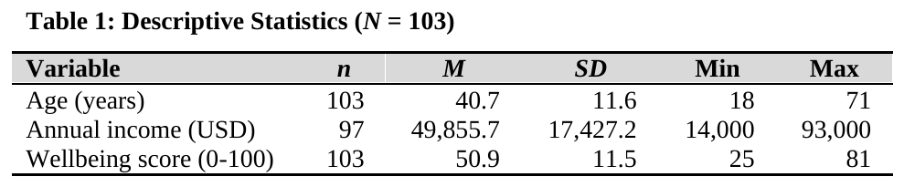

```{r}
#| label: obx-setup
#| include: false

# ---------------------------------------------------------------------------
# CONSOLE FACSIMILES -- render scaffolding, hidden (include: false). Same
# mechanism as anova.qmd: pane_facsimile.R defines the capture-once /
# display-twice helpers in their own dot-named environment (.obx). Each block
# below is one call whose code STRING is both printed into the page and
# executed once, so the shown code and the run code cannot drift. An
# unexpected error in any block HALTS the render (the publish gate).
#
# Devices, by the OUTPUT-REGISTER rule: the prose and the boxes READ the output
# of blocks 1-3 and 6, so those panes render OPEN
# (.obx$show_console(fence = TRUE)). Block 5's printout is some 200 lines, the
# reader's own result to check: a collapsed "What you should see" box
# (.obx$show_block()). Block 4 is comments only (the step happens in RStudio's
# editor), so it is a plain fence.
#
# THE READER'S EDIT. A render cannot type into the editor, so the hidden chunk
# "the-edit" (after block 4) makes, in styles/mystyle.jstyle, the two changes
# block 4 asks for; the page says so in its prose.
#
# YOUR OWN TABLE STYLES, PAGE 3 (S422 review; was Publication tables page
# 7). It builds on pages 1-2 (the style folder);
# Jeff, S421: "we should briefly include or even emphasise making changes
# manually to the style here".
#
# jstats is NOT pre-loaded: block 1 teaches library(jstats), and R prints the
# startup message on first attach only. joutput()/joptions() are left alone. The
# page WRITES files into the working directory (a styles folder and a Word
# file); the clean-slate lines below clear them before the blocks run, and the
# teardown clears them after. Only the Publication tables pages' files are removed (the
# shared list below); the styles folder goes only when it is left empty.
#
# HOW-TO LAYOUT (S344). No top boxes: the shared material lives once on
# howtos.qmd, and this page points there.
#
# S428 (the S427 wording pass, Fable 5.2, okayed by Jeff): the recurring
# changes A-M and L (pages 3 to 5 are three ways to change a style, "pick
# one") and the page's 21 numbered changes.
# ---------------------------------------------------------------------------

options(width = 80)   # match a default 80-column console for table alignment
options(jstats.attach.noninteractive = TRUE)   # let block 1 show the real startup message

# THE SHARED LIST (S422): every Publication tables page's files, so a render
# halted on one page cannot leave a style file in the styles folder another
# page creates and lists. A styles folder still holding anything else HALTS
# the render: it is not this page's to remove.
.tables_files <- c("styles/myreport.jstyle", "styles/mystyle.jstyle",
                   "styles/myblue.jstyle", "styles/mytest.txt",
                   "styles/mytest.jstyle", "styles/mymatch.jstyle",
                   "myblue.txt", "mymatch.txt", "Descriptives.docx",
                   "Regression.docx", "Report.docx", "Report_report.docx",
                   "Table1_mystyle.docx", "Table1_report.docx",
                   "Table1_myblue.docx", "Tables_mymatch.docx",
                   "Models.docx")
.bh_clean <- function() {
  f <- .tables_files[file.exists(.tables_files)]
  if (length(f)) file.remove(f)
  if (dir.exists("styles") &&
      !length(list.files("styles", all.files = TRUE, no.. = TRUE)))
    unlink("styles", recursive = TRUE)
  invisible(NULL)
}
.bh_clean()
if (dir.exists("styles"))
  stop("The project's styles folder holds files no Publication tables page ",
       "wrote. Move them out and render again.", call. = FALSE)

source("pane_facsimile.R")   # defines .obx (dot-named); turns the output color on
```

## Changing a style by hand

**Your own table styles &middot; Page 3**\
*Pages 3 to 5 show three ways to change a style: pick one. This page is the
first, and it follows [2. Keeping your styles](tables-keeping-styles.qmd).*

This page is a hands-on run-through of changing a style yourself: you save a
copy of a built-in style as a style file, change a value or two in RStudio, and
check the file before you make a table with it.

A *style file* is a plain-text file listing every setting a table's look
depends on, one to a line, each after a note saying what it does and what
values it takes. Changing a style means changing the value after a setting's
equals sign. On page 4,
[Changing a style with an AI assistant](tables-ai-assistant.qmd), an AI
assistant makes the changes instead; the copy and the check are the same either
way.

This page follows the pattern of every How-To: numbered blocks of code that
build one script, with the finished script to download at the bottom.
[Using the How-To pages](howtos.qmd#using-the-how-to-pages) explains the
pattern, and how to reset your session if something goes wrong.

### 1. Load jstats and the data

We'll work on `community`, one of the two practice datasets that ship with the
package: 103 simulated respondents to a community survey. `jload()` puts a copy
of it in your workspace, and `juse()` makes `community` the default data frame,
so the commands that follow can leave its name out.

```{r}
#| echo: false
#| results: asis
.obx$show_console(r"---(## ---- 1. Load jstats and the data --------------------------------------

## Load jstats and the community practice dataset, and make community the
## default data frame. quiet = TRUE skips jload()'s report on what it
## loaded; overwrite = TRUE replaces a copy already loaded in this session
## without asking first
library(jstats)
jload("community", overwrite = TRUE, quiet = TRUE)
juse(community))---", fence = TRUE,
  lead = "The command lines are shown; the standalone <code>##</code> comment lines aren't -- running a comment just echoes it back and does nothing.")
```

### 2. A table in the report style

First, make a table to compare the changed one with: descriptive statistics for
three variables, saved as `d1`, in the built-in `report` style. `style =` names
the style a table is built in.

```{r}
#| echo: false
#| results: asis
.obx$show_console(r"---(## ---- 2. A table in the report style -----------------------------------

## Save a result, then make a table from it in the built-in report style
d1 <- jdesc(Age, Income, WellbeingScore, print = FALSE)
t1 <- jtable(d1, style = "report")

## print() is base R: it shows an object in the Console, here the table
print(t1)  # base R)---", fence = TRUE)
```

```{r}
#| label: age-cells
#| include: false
# The mean age the prose quotes, read from the printed table (gated below).
.pr <- function(x) utils::capture.output(print(x))
.agecell <- function(t) {
  r <- grep("^Age \\(years\\)", .pr(t), value = TRUE)
  stopifnot(length(r) == 1L)
  strsplit(trimws(sub("^Age \\(years\\)", "", r)), " +")[[1]][2]
}
.bh_age_before <- .agecell(t1)
.bh_dec_before <- c("one", "two", "three")[nchar(sub("^.*\\.", "", .bh_age_before))]
```

The table shows its statistics to `r .bh_dec_before` decimal places: a mean
age of `r .bh_age_before`, for example. With no `file =`, `jtable()` writes no
Word file, and says so.

### 3. A copy of report to change

The built-in styles have no file of their own to change. `jstyle()` with
`save.as =` writes a copy of one as a style file. The copy goes into the style
folder, which this block sets, as page 1 did, to a folder named `styles` inside
your project.

```{r}
#| echo: false
#| results: asis
.obx$show_console(r"---(## ---- 3. A copy of report to change ------------------------------------

## Keep this page's styles in a styles folder inside the project. jstats
## makes the folder; the setting lasts until R restarts
joptions(style.dir = "styles")

## Save a complete copy of report as mystyle, every setting written out
## with a note. open = TRUE opens the copy in a tab beside your script
jstyle("report", save.as = "mystyle", open = TRUE))---", fence = TRUE)
```

```{r}
#| label: copy-lines
#| include: false
.bh_copy <- readLines("styles/mystyle.jstyle", encoding = "UTF-8")
.bh_n_lines <- length(.bh_copy)
```

jstats wrote the copy, `mystyle.jstyle`, into the `styles` folder, and with
`open = TRUE` the file opens in a tab beside your script. On your screen the
copy's path starts with your own working directory (your project's folder),
which this page shows as `~/your-working-directory`. The file is about
`r format(round(.bh_n_lines, -2))` lines long: every setting jstats has, each
after its note. The general settings come first, the ones that set the look of
every table, such as the font, the size, and the decimal places. Then each kind
of table has a section of its own, under its name in square brackets, such as
`[descriptives]` and `[regression]`, and `[plot]` comes last, for charts.

::: {.callout-note collapse="true" title="Reading this output"}
The first three lines are `joptions()` confirming the setting it changed. The
next two say that jstats created the folder, and where it wrote the file.
:::

### 4. Change two values, and save

This step happens in the `mystyle.jstyle` tab, not in the Console. The block
below is only comments, a note in your script of what you did.

```r
## ---- 4. Change two values, and save -----------------------------------

## In the mystyle.jstyle tab: font = Times New Roman, decimals = 1, saved
```

In the `mystyle.jstyle` tab:

1. **Find the font.** Press Ctrl+F (Cmd+F on a Mac), type `font = Arial`, and
   press Enter. The first match is the general setting, near the top under
   "The general settings". (A second `font` line, under `[plot]`, sets the
   charts' font; leave it as it is.)
2. **Change the value.** Replace `Arial` with `Times New Roman`, so the line
   reads `font = Times New Roman`. Change only what follows the equals sign: the
   setting's name stays as it is.
3. **Find the decimals.** Search for `decimals = 2`, and change it to
   `decimals = 1`. The note above it says what the setting takes: "a whole
   number from 0 to 6".
4. **Save the file**, with Ctrl+S (Cmd+S on a Mac). jstats reads the file as it
   is saved on disk, so a change that isn't saved doesn't count.

```{r}
#| label: the-edit
#| include: false
# THE READER'S EDIT, made here because a render cannot type into the editor:
# the two changes block 4 asks for, on the first line of each name (the
# general setting).
.ed <- .bh_copy
.set1 <- function(x, from, to) {
  i <- which(x == from)
  stopifnot(length(i) >= 1L)
  x[i[1]] <- to
  x
}
.ed <- .set1(.ed, "font = Arial", "font = Times New Roman")
.ed <- .set1(.ed, "decimals = 2", "decimals = 1")
stopifnot(which(.ed == "font = Times New Roman") < grep("^\\[descriptives\\]", .ed),
          which(.ed == "decimals = 1") < grep("^\\[descriptives\\]", .ed),
          sum(.ed == "font = Arial") == 1L)   # the [plot] line, left as it was
writeLines(.ed, "styles/mystyle.jstyle", useBytes = TRUE)
```

### 5. Check the file

`jstyle()` with a style's name reads the style file and shows every setting in
the Console. If a line holds something jstats can't use, `jstyle()` stops at
that line and names it, so run it after every change.

```{r}
#| echo: false
#| results: asis
.obx$show_block(r"---(## ---- 5. Check the file ------------------------------------------------

## jstyle() reads the saved file and shows every setting. It stops at a
## line it cannot use, and names the line
jstyle("mystyle"))---", chrome = TRUE)
```

`jstyle()` read the file without stopping, and the two changes are in the
settings it lists: `font = Times New Roman` at the top, and `decimals = 1`
further down the general settings.

::: {.callout-note collapse="true" title="Reading this output"}
- **The top lines** name the style, the file it was read from, and the styles
  it is based on: "based on report, then apa". A setting the file left out
  would come from `report`, and a setting that `report` leaves out would come
  from `apa`. A complete copy leaves out nothing, so the next line says "Set in
  this file: every setting."
- **The settings** follow in the file's order: the general settings first,
  then each kind of table's section under its name in square brackets, then
  `[plot]`, for charts.
- **If the list still shows Arial**, the change wasn't saved, or jstats
  read a different file. Save the tab, and check that the `styles` folder holds
  `mystyle.jstyle`.
:::

### 6. The table in your style

Now make the same table in `mystyle`, and write it to a Word file. A table
keeps the style it was made in, so the new table is made from the result, `d1`,
not from `t1`.

```{r}
#| echo: false
#| results: asis
.obx$show_console(r"---(## ---- 6. The table in your style ---------------------------------------

## Make a table from the same result in your style, and write it to a
## Word file
t2 <- jtable(d1, style = "mystyle", file = "Table1_mystyle.docx", open = TRUE)
print(t2)  # base R)---", fence = TRUE)
```

```{r}
#| label: age-after
#| include: false
.bh_age_after <- .agecell(t2)
```

The statistics now have one decimal place, a mean age of `r .bh_age_after`, and
the Word file has the table in Times New Roman. The font is a change only Word
shows: in the Console, every table is in the Console's own font.

{width=560px fig-alt="A descriptive statistics table in Word in the changed style: the caption 'Table 1: Descriptive Statistics (N = 103)' in bold, a light gray header row, the statistics to one decimal place."}

::: {.callout-note collapse="true" title="Why jstats does it this way"}
A jstats style is a plain-text file, one setting to a line, each with a note on
what it does and what it takes. So a style can be read and changed in any text
editor, with no special program, and a change is one value on one line. A
journal's style or an agency's is one small file, which you can email to a
colleague or copy to a new computer.

The style is kept apart from the analysis, so one change to the file changes
every table made with it: run the script again, and every table is rebuilt in
the new look.
:::

::: {.callout-tip collapse="true" title="Coming from SPSS, Stata, or SAS?"}
A jstats style does the job of **SPSS**'s TableLooks: in the Viewer, a pivot
table's look can be saved as a TableLook file (.stt) and applied to other
tables, and a default TableLook set for new output. The difference is where
the look is applied. A TableLook styles tables already in the Viewer, and a table
exported to Word takes the look it had there; a jstats style is applied as
`jtable()` builds the Word table.

In **Stata**, `collect style` commands set the look of a table built with
`collect`, and `collect style save` keeps them in a file for `collect style
use`; `collect export` writes the table to Word.

In **SAS**, the look of ODS output comes from an ODS style, made or changed
with `PROC TEMPLATE` and named in the ODS RTF or ODS WORD statement that
writes the file.
:::

::: {.callout-note collapse="true" title="Going deeper (optional)"}
A general setting can take a value of its own for one kind of table: copy the
setting's line under that table's heading in the file, and change the value
there. `decimals = 3` copied under `[regression]`, for instance, gives
regression tables three decimal places and leaves every other table as it was.
This works for every general setting except `paper`, which sets the paper size
of the whole Word file, and under every heading except `[plot]`, which takes only a
chart's own settings. The help page `?jstyle_settings` lists every setting and
what it takes. The books cover every setting in depth, and designing a house
style, with worked examples.
:::

```{r}
#| label: stop-messages
#| include: false
# The two messages quoted above, built by running jstyle() on two broken copies
# of the file block 5 read, so the quotations are the package's own.
.td <- tempfile("bh-msgs-"); dir.create(.td)
.broken <- function(lines) {
  f <- file.path(.td, "mystyle.jstyle"); writeLines(lines, f, useBytes = TRUE); f
}
.err <- function(expr) tryCatch({ expr; NA_character_ },
                                error = function(e) conditionMessage(e))
.flat <- function(s) trimws(gsub("\\s+", " ", s))
.ed1 <- .ed; .ed1[which(.ed1 == "decimals = 1")[1]] <- "decimal = 1"
.ed2 <- .ed; .ed2[which(.ed2 == "decimals = 1")[1]] <- "decimals = one"
.bh_msg_name  <- sub("^jstyle\\(\\): ", "", .flat(.err(jstyle(.broken(.ed1)))))
.bh_msg_value <- sub("^jstyle\\(\\): ", "", .flat(.err(jstyle(.broken(.ed2)))))
```

## When jstyle() stops

A slip in the file, such as a misspelled setting or a value the setting doesn't
take, makes `jstyle()` stop at that line and say what is wrong. Two examples,
each made from this page's file with one line changed:

- `decimal = 1`, with the *s* left off. The message reads
  `` `r .bh_msg_name` ``
- `decimals = one`, a word where a number belongs. The message reads
  `` `r .bh_msg_value` ``

Fix the line the message names, save the file, and run `jstyle()` again. Your
own message gives the line number in your file.

## Changing it again

Close the Word file, change the style file, save it, and run blocks 5 and 6
again. `jtable()` asks before replacing the Word file it wrote earlier: answer
`y`. Block 3 is different: run it again, and `jstyle()` asks before replacing
`mystyle.jstyle` with a fresh copy of `report`. Answer `n` (no) to keep your
changes.

```{r}
#| label: prose-gates
#| include: false

# ---------------------------------------------------------------------------
# PROSE GATES -- hidden. Each stopifnot() below is one statement the prose
# makes about what the package does; a false one HALTS the render, the same
# publish gate the blocks have. Each gate compares two runs that differ in the
# one thing the prose claims, so it can fail.
# ---------------------------------------------------------------------------
.chk <- utils::capture.output(jstyle("mystyle"))
.out2 <- utils::capture.output(jtable(d1, style = "report"))
.row <- function(x, lab) x[grepl(paste0("^", lab), x)]
.age1 <- .row(.pr(t1), "Age"); .age2 <- .row(.pr(t2), "Age")
# "One kind of table only": decimals = 3 under [regression] moves a
# regression table and leaves a descriptives table as it was
.var <- function(lines, extra, after) {
  f <- tempfile("bh-var-", tmpdir = .td, fileext = ".jstyle")
  writeLines(append(lines, extra, after = after), f, useBytes = TRUE); f
}
.reg3 <- .var(.ed, "decimals = 3", which(.ed == "[regression]"))
.m1   <- jlm(WellbeingScore ~ Age, print = FALSE)
.ppr  <- .var(.ed, "paper = letter", which(.ed == "[regression]"))

stopifnot(
  # block 2: two decimal places, the mean age as quoted; no file asked for
  grepl(paste0(" ", .bh_age_before, " "), .age1), .bh_dec_before == "two",
  nchar(sub("^.*\\.", "", .bh_age_after)) == 1L,
  any(grepl("no Word file was asked for", .out2, fixed = TRUE)),
  # block 3: the file opens with a note, the general settings first
  .bh_n_lines > 700, .bh_n_lines < 900,
  grep("^font = ", .bh_copy)[1] < grep("^\\[descriptives\\]", .bh_copy),
  grep("^\\[plot\\]", .bh_copy) > grep("^\\[multiresponse\\]", .bh_copy),
  any(grepl("^# takes: a whole number from 0 to 6$", .bh_copy)),
  # block 5: the printout's top lines and the two values
  any(grepl("based on report, then apa", .chk, fixed = TRUE)),
  any(grepl("Set in this file: every setting.", .chk, fixed = TRUE)),
  any(grepl("^font += Times New Roman$", .chk)), any(grepl("^decimals += 1$", .chk)),
  grep("^font += Times New Roman$", .chk) < grep("^decimals += 1$", .chk),
  # block 6: one decimal place, the mean age as quoted, the file written
  grepl(paste0(" ", .bh_age_after, " "), .age2), !identical(.pr(t1)[-1], .pr(t2)[-1]),
  file.exists("Table1_mystyle.docx"),
  # the stops: a misspelled setting and a value the setting doesn't take
  grepl("decimal", .bh_msg_name, fixed = TRUE), grepl("Did you mean decimals?", .bh_msg_name, fixed = TRUE),
  grepl("decimals = one", .bh_msg_value, fixed = TRUE), grepl("must be", .bh_msg_value, fixed = TRUE),
  # going deeper: one kind of table only, and paper under a heading stops
  !identical(.pr(jtable(.m1, style = "mystyle", print = FALSE)),
             .pr(jtable(.m1, style = .reg3, print = FALSE))),
  identical(.pr(jtable(d1, style = "mystyle", print = FALSE)),
            .pr(jtable(d1, style = .reg3, print = FALSE))),
  !is.na(.err(jstyle(.ppr)))
)
unlink(.td, recursive = TRUE)
```

## Take the whole script with you

That's the full run-through. If you'd like the entire script in one file to
keep and reuse, download it here. Put your own result in place of `d1`, and
your own style's name in place of `mystyle`.

The file is the finished version of the script you built: the same code, in the
same order. Block 4 is still only comments: the change happens in the editor,
not in R. If you run the file again, jstats asks before replacing each file it
wrote earlier; the file's first lines say what to answer.
[Using the How-To pages](howtos.qmd#using-the-how-to-pages) says more about
finished scripts and how to run one.

<div style="margin: 1rem 0 2rem;">
<a href="tables-by-hand-follow-along.R" download class="btn btn-primary">Download the full script (.R)</a>
</div>

```{r}
#| label: obx-teardown
#| include: false
# Page-end teardown: remove the files the render wrote (the setup chunk also
# clears them at render start, against a halted render).
.bh_clean()
```
