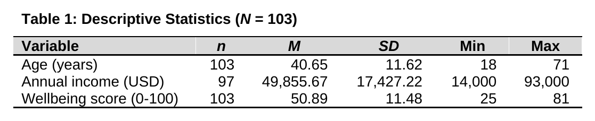

```{r}
#| label: obx-setup
#| include: false

# ---------------------------------------------------------------------------
# CONSOLE FACSIMILES -- render scaffolding, hidden (include: false). Same
# mechanism as anova.qmd: pane_facsimile.R defines the capture-once /
# display-twice helpers in their own dot-named environment (.obx). Each block
# below is one call whose code STRING is both printed into the page and
# executed once, so the shown code and the run code cannot drift. An
# unexpected error in any block HALTS the render (the publish gate).
#
# Devices, by the OUTPUT-REGISTER rule: the prose READS the output of blocks
# 1-4, so those panes render OPEN (.obx$show_console(fence = TRUE)). Block 3
# draws a chart as well: the chunk "report-chart" after it draws the same chart
# in report for the page.
#
# PUBLICATION TABLES, PAGE 5 (page 4 until the S422 review; written in place of the S422 stub, Jeff:
# "should 4 be about the built in report style as an alternative to apa").
# It uses page 1's saved results; block 1 makes them again. A table built in
# a style keeps it (jtable() stops on style = with a built table), so block 3
# rebuilds the tables and redraws the chart after joptions(style = "report").
# joptions(style = NULL) changes nothing at v0.9.282 (S422 finding), so block
# 4 goes back with style = "apa".
#
# jstats is NOT pre-loaded: block 1 teaches library(jstats), and R prints the
# startup message on first attach only. joutput()/joptions() are left alone
# except as the blocks set them; block 4 puts the style back. The page WRITES
# one Word file, into the output folder, Tables; the clean-slate line below
# removes it, and the folder when it is left empty, before the blocks run, and
# the teardown after.
#
# S431 (Jeff's S429 read of the Publication tables pages, okayed): the page
# assumes the output folder page 2 sets, and says so at block 3; a hidden
# chunk after block 1 sets it out of sight, so the Word file is where that
# reader finds it. Report_report.docx is Tables_v2.docx (Jeff: "Two reports
# together with the underscore between ... Can we select a new name for the
# file?"; "Okay with all names."); the opening line names what the page uses
# and that block 1 makes the results again.
#
# HOW-TO LAYOUT (S344). No top boxes: the shared material lives once on
# howtos.qmd, and this page points there.
#
# S428 (the S427 wording pass, Fable 5.2, okayed by Jeff): the recurring
# changes A-M and the page's 22 numbered changes; gates for the summary's
# "no Word file" line, a chart keeping the style it was made in, and a copy
# under a built-in style's name refused (in a temporary style folder).
# ---------------------------------------------------------------------------

options(width = 80)   # match a default 80-column console for table alignment
options(jstats.attach.noninteractive = TRUE)   # let block 1 show the real startup message

.cs_files <- file.path("Tables", c("Tables_v2.docx"))
.cs_clean <- function() {
  f <- .cs_files[file.exists(.cs_files)]
  if (length(f)) file.remove(f)
  if (dir.exists("Tables") &&
      !length(list.files("Tables", all.files = TRUE, no.. = TRUE)))
    unlink("Tables", recursive = TRUE)
  invisible(NULL)
}
.cs_clean()

source("pane_facsimile.R")   # defines .obx (dot-named); turns the output color on
```

## Choosing a style: apa or report

**Publication tables &middot; Page 5**\
*This page uses the two results you saved on
[1. Saving results](tables-saving-results.qmd), and remakes the file from
[3. Several tables and a chart in one file](tables-several.qmd). Its first block
makes the results again, so you can start here in a new session.*

A *style* is the set of choices that decide how every table and chart looks
when `jtable()` writes it to Word: the font and its size, the caption, the
shading, which lines are drawn, the decimal places, and many more. jstats has
two built-in styles:

- **`apa`** follows APA 7 (the American Psychological Association's style), for
  journal manuscripts, and is the default: every table on pages 2 to 4 is in
  `apa`.
- **`report`** is the plain look shared by the style manuals that agencies and
  institutes write for their reports: Arial 10, "Table 1:" and the title on one
  line, a light gray header row.

This page is a hands-on run-through of choosing between them, for one table or
for a whole session, and of what changes when you do.

This page follows the pattern of every How-To: numbered blocks of code that
build one script, with the finished script to download at the bottom.
[Using the How-To pages](howtos.qmd#using-the-how-to-pages) explains the
pattern, and how to reset your session if something goes wrong.

Block 1 repeats the steps from page 1 that saved the two results, so this page
works in a fresh session too. If `d1` and `m1` are still listed in your
**Environment** pane, running block 1 does no harm: it saves the same two
results again.

### 1. Load jstats and save the two results again

```{r}
#| echo: false
#| results: asis
.obx$show_console(r"---(## ---- 1. Load jstats and save the two results again --------------------

## Load jstats and community, make community the default data frame, and
## save page 1's two results again: d1, descriptive statistics, and m1, a
## regression. quiet = TRUE skips jload()'s report, which page 1 shows;
## overwrite = TRUE replaces a copy loaded earlier without asking first
library(jstats)
jload("community", overwrite = TRUE, quiet = TRUE)
juse(community)
d1 <- jdesc(Age, Income, WellbeingScore, print = FALSE)
m1 <- jlm(WellbeingScore ~ Age + Income, print = FALSE))---", fence = TRUE,
  lead = "The command lines are shown; the standalone <code>##</code> comment lines aren't -- running a comment just echoes it back and does nothing.")
```

```{r}
#| label: output-folder
#| include: false
# The output folder page 2 sets, which this page assumes (block 3 says so):
# set here out of sight, so the Word file is where that reader finds it. The
# teardown removes the folder when it is left empty.
invisible(joptions(output.dir = "Tables", quiet = TRUE))
```

### 2. One table in the report style

`style =` in a `jtable()` call names the style for that one table.

```{r}
#| echo: false
#| results: asis
.obx$show_console(r"---(## ---- 2. One table in the report style ---------------------------------

## Make a table from d1 in the built-in report style, saved as t1
t1 <- jtable(d1, style = "report")

## print() is base R: it shows an object in the Console, here the table
print(t1)  # base R)---", fence = TRUE)
```

With no `file =`, `jtable()` writes no Word file, and its last line says so.
The caption, the table's number and title, is now on one line, "Table 1:" and
the title, where `apa` puts "Table 1" on a line of its own with the title under
it. The numbers are the same: both styles show statistics to two decimal
places. The rest of the change is the look, which only Word shows. Block 3
writes the Word file; this is the table in it:

{width=560px fig-alt="A descriptive statistics table in Word in the report style: the caption 'Table 1: Descriptive Statistics (N = 103)' in bold, a light gray header row, three variable rows."}

### 3. The report style for the whole session

To use `report` for every table, set it as the session's style with
`joptions()`, rather than adding `style =` to each call. The setting lasts
until R restarts. A table or a chart keeps the style it was made in, so make
the tables and the chart again after you change the setting. As on page 2, the
block assumes you've already set your output folder with
`joptions(output.dir = "Tables")`, so the Word file goes in `Tables`. To set
the folder once for every session, put that line in your project's
`.Rprofile`, as [Loading jstats automatically](loading-jstats-automatically.qmd)
shows.

```{r}
#| echo: false
#| results: asis
grDevices::pdf(NULL)   # the chart block 3 draws: on a null device, not the page (S350)
.obx$show_console(r"---(## ---- 3. The report style for the whole session ------------------------

## Make report the style for the rest of the session
joptions(style = "report")

## Remake page 3's tables and chart, now in report, and write them to one
## Word file
t1 <- jtable(d1, print = FALSE)
t2 <- jtable(m1, print = FALSE)
p1 <- jplot(Region)
jtable(list(t1, p1, t2), file = "Tables_v2.docx", open = TRUE))---", fence = TRUE)
invisible(grDevices::dev.off())
```

`joptions()` confirms the style, and `Tables_v2.docx` holds page 3's two
tables and its chart, all in `report`. The chart changes with the tables: its
caption takes the same form as theirs, "Figure 1:" and the title on one line,
and `report` draws the chart
itself with horizontal gridlines and only the bottom axis line, where `apa`
draws both axis lines and no gridlines:

```{r}
#| label: report-chart
#| echo: false
#| results: hide
#| message: false
#| fig-width: 6
#| fig-height: 4
#| fig-alt: "The same bar chart of respondents by region of residence in the report style: one gray bar per region, the count printed above each, horizontal gridlines, and an axis line along the bottom only."
print(p1)
```

::: {.callout-tip collapse="true" title="Coming from SPSS, Stata, or SAS?"}
`joptions(style = )` does what **SPSS**'s default TableLook does: under Edit >
Options, on the Pivot Tables tab, the TableLook chosen there is applied to
every new table. `style =` in a single call is the jstats version of applying a
TableLook to one table.

In **SAS**, the STYLE= option on an ODS statement chooses the style for that
destination's output, such as the built-in Journal style for plain,
black-and-white tables.
:::

### 4. Back to apa

`joptions(style = "apa")` puts the default back, for the tables you make next.

```{r}
#| echo: false
#| results: asis
.obx$show_console(r"---(## ---- 4. Back to apa ---------------------------------------------------

## Make apa the session's style again
joptions(style = "apa"))---", fence = TRUE)
```

Tables already made keep their style: `t1` and `t2` are still in `report`. To
start every session in `report`, put the `joptions(style = "report")` line in
your project's `.Rprofile`, the file
[Loading jstats automatically](loading-jstats-automatically.qmd) sets up, below
its `library(jstats)` line.

Neither built-in style can itself be changed. To change one, save a copy of it
as a style file of your own: the next topic, *Your own table styles*, shows
how, starting with [1. Making your own style](tables-own-style.qmd).

```{r}
#| label: prose-gates
#| include: false

# ---------------------------------------------------------------------------
# PROSE GATES -- hidden. Each stopifnot() below is one statement the prose
# makes about what the package does; a false one HALTS the render, the same
# publish gate the blocks have.
# ---------------------------------------------------------------------------
.msgs <- function(expr) {         # what a call prints, both streams, as one string
  m <- character(0)
  o <- withCallingHandlers(utils::capture.output(expr),
                           message = function(c) { m <<- c(m, conditionMessage(c))
                                                   invokeRestart("muffleMessage") })
  paste(c(o, m), collapse = "\n")
}
.pr <- function(x) { x <- utils::capture.output(print(x)); x[nzchar(trimws(x))] }
.rows <- function(x) x[grepl("^(Age|Annual|Wellbeing)", x)]
.styl <- function(s) utils::capture.output(jstyle(s))
.td <- tempfile("cs-"); dir.create(.td)
.apa_t <- jtable(d1, style = "apa", print = FALSE)
.rep_t <- jtable(d1, style = "report", print = FALSE)
.pr_built <- .pr(t1)
grDevices::pdf(NULL)
.rp <- .styl("report"); .ap <- .styl("apa")
.plot_line <- function(x, key) {
  i <- grep("^\\[plot\\]", x)
  sub("\\s+#.*$", "", grep(paste0("^", key, " "), x[i:length(x)], value = TRUE)[1])
}
# block 3's file, captions in report's form
.doc <- jtable(list(t1, p1, t2), file = file.path(.td, "R.docx"), print = FALSE)
.cap <- .pr(.doc)
invisible(grDevices::dev.off())
# block 4: "apa" puts the default back (style = NULL leaves the style as it
# is, with a note since v0.9.283, R86; the page teaches "apa")
.cur <- .msgs(joptions())
# block 2: with no file =, the summary's last line says no Word file was written
.m2 <- strsplit(.msgs(jtable(d1, style = "report")), "\n", fixed = TRUE)[[1]]
.m2 <- .m2[nzchar(trimws(.m2))]
# block 3: a chart keeps the style it was made in -- one made under apa keeps
# apa's caption form after the session's style changes
invisible(utils::capture.output(joptions(style = "apa")))
.p_apa <- jplot(Region)
invisible(utils::capture.output(joptions(style = "report")))
.cap_kept <- .pr(jtable(list(.p_apa), print = FALSE))
invisible(utils::capture.output(joptions(style = "apa")))
# the last paragraph: a built-in style can't itself be changed -- a copy under
# its name is refused (run under a temporary style folder, so nothing can reach
# the render machine's own folders)
.sd <- file.path(.td, "styles")
invisible(utils::capture.output(joptions(style.dir = .sd)))
.e_builtin <- tryCatch({ jstyle("report", save.as = "report"); NA_character_ },
                       error = function(e) conditionMessage(e))
invisible(utils::capture.output(joptions(style.dir = NULL)))
# style = cannot restyle a built table
.e_built <- tryCatch({ jtable(t1, style = "apa"); NA_character_ },
                     error = function(e) conditionMessage(e))

stopifnot(
  # block 2: one line against two, the same numbers
  .pr(.rep_t)[1] == "Table 1: Descriptive Statistics (N = 103)",
  .pr(.apa_t)[1] == "Table 1",
  identical(.rows(.pr(.apa_t)), .rows(.pr(.rep_t))),
  any(grepl("^decimals += 2\\b", .rp)),
  any(grepl("^decimals += 2", .ap)),
  any(grepl("^font += Arial$", .rp)), any(grepl("^size += 10$", .rp)),
  any(grepl("^header.fill += D9D9D9$", .rp)),
  # block 3: the session's style built t1, t2 and p1 in report
  .pr_built[1] == "Table 1: Descriptive Statistics (N = 103)",
  file.exists(file.path("Tables", "Tables_v2.docx")), !file.exists("Tables_v2.docx"),
  any(grepl("^Table 1: Descriptive", .cap)), any(grepl("^Figure 1: Region", .cap)),
  any(grepl("^Table 2: Regression", .cap)),
  .plot_line(.rp, "gridlines") == "gridlines       = horizontal",
  .plot_line(.ap, "gridlines") == "gridlines       = none",
  .plot_line(.rp, "axis.lines") == "axis.lines      = x",
  .plot_line(.ap, "axis.lines") == "axis.lines      = both",
  grepl("no Word file was asked for", .m2[length(.m2)], fixed = TRUE),
  .cap_kept[1] == "Figure 1", grepl("^Region of residence", .cap_kept[2]),
  grepl("is the name of a style built into jstats", .e_builtin, fixed = TRUE),
  length(list.files(.sd)) == 0L,
  # block 4: apa again
  grepl("Publication style: apa", .cur, fixed = TRUE),
  .pr(jtable(d1, print = FALSE))[1] == "Table 1",
  # a built table keeps its style
  !is.na(.e_built)
)
unlink(.td, recursive = TRUE)
```

## Take the whole script with you

That's the full run-through. If you'd like the entire script in one file to
keep and reuse, download it here. Put your own results in place of `d1` and
`m1`.

The file is the finished version of the script you built: the same code, in the
same order. If you run the file a second time, `jtable()` asks before replacing
`Tables_v2.docx`; the file's first lines say what to answer.
[Using the How-To pages](howtos.qmd#using-the-how-to-pages) says more about
finished scripts and how to run one.

<div style="margin: 1rem 0 2rem;">
<a href="tables-choosing-a-style-follow-along.R" download class="btn btn-primary">Download the full script (.R)</a>
</div>

```{r}
#| label: obx-teardown
#| include: false
# Page-end teardown: remove the file the render wrote (the setup chunk also
# clears it at render start, against a halted render), and leave the style
# as a first-time reader's.
.cs_clean()
invisible(utils::capture.output(joptions(style = "apa")))
```
