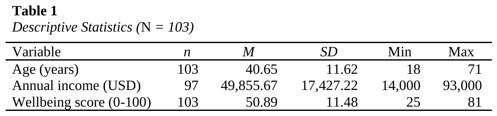
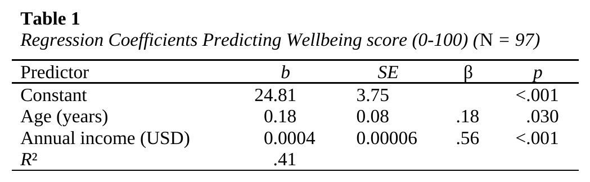

```{r}
#| label: obx-setup
#| include: false

# ---------------------------------------------------------------------------
# CONSOLE FACSIMILES -- render scaffolding, hidden (include: false). Same
# mechanism as anova.qmd: pane_facsimile.R defines the capture-once /
# display-twice helpers in their own dot-named environment (.obx). Each block
# below is one call whose code STRING is both printed into the page and
# executed once, so the shown code and the run code cannot drift. An
# unexpected error in any block HALTS the render (the publish gate).
#
# Devices, by the OUTPUT-REGISTER rule: the prose and the "Reading this output"
# box READ the output of blocks 1-3, so those panes render OPEN
# (.obx$show_console(fence = TRUE)).
#
# PUBLICATION TABLES, PAGE 2 (S422). It uses page 1's saved results, d1 and
# m1; block 1 makes them again, so the page and its script also work in a
# fresh session (Jeff, S422: "okay on your recommendation for the top block
# that repeats the final steps necessary to move on with the page").
#
# jstats is NOT pre-loaded: block 1 teaches library(jstats), and R prints the
# startup message on first attach only. joutput()/joptions() are left alone.
# The page WRITES two Word files into the working directory; the clean-slate
# line below removes them before the blocks run (a halted render never reaches
# the teardown chunk at the foot), and the teardown removes them after.
#
# HOW-TO LAYOUT (S344). No top boxes: the shared material lives once on
# howtos.qmd, and this page points there.
#
# S428 (the S427 wording pass, Fable 5.2, okayed by Jeff): the recurring
# changes A-M (Console wording; jtable()'s "summary"; the block 1 paragraph
# below the pattern paragraph; "lines" and "column headings"; the working
# directory glossed; the serial comma) and the page's 30 numbered changes.
# Block 1's text says how to see a quiet result's output (type its name, R85),
# gated in prose-gates.
# ---------------------------------------------------------------------------

options(width = 80)   # match a default 80-column console for table alignment
options(jstats.attach.noninteractive = TRUE)   # let block 1 show the real startup message

.tw_files <- c("Descriptives.docx", "Regression.docx")
.tw_clean <- function() {
  f <- .tw_files[file.exists(.tw_files)]
  if (length(f)) file.remove(f)
  invisible(NULL)
}
.tw_clean()

source("pane_facsimile.R")   # defines .obx (dot-named); turns the output color on
```

## Making a table in Word

**Publication tables &middot; Page 2**\
*It uses `d1` and `m1`, the two results saved on
[1. Saving results](tables-saving-results.qmd).*

This page is a hands-on run-through of `jtable()`, which turns a saved result
into a formatted table in a Word file. You'll make a table from each of page 1's
two results, each in a Word file of its own.

This page follows the pattern of every How-To: numbered blocks of code that
build one script, with the finished script to download at the bottom.
[Using the How-To pages](howtos.qmd#using-the-how-to-pages) explains the
pattern, and how to reset your session if something goes wrong.

Block 1 repeats the steps from page 1 that saved the two results, so this page
works in a fresh session too. If `d1` and `m1` are still listed in your
**Environment** pane from page 1, running block 1 does no harm: it saves the
same two results again.

### 1. Load jstats and save the two results again

```{r}
#| echo: false
#| results: asis
.obx$show_console(r"---(## ---- 1. Load jstats and save the two results again --------------------

## Load jstats and community, make community the default data frame, and
## save page 1's two results again: d1, descriptive statistics, and m1, a
## regression. quiet = TRUE skips jload()'s report, which page 1 shows;
## overwrite = TRUE replaces a copy loaded earlier without asking first
library(jstats)
jload("community", overwrite = TRUE, quiet = TRUE)
juse(community)
d1 <- jdesc(Age, Income, WellbeingScore, print = FALSE)
m1 <- jlm(WellbeingScore ~ Age + Income, print = FALSE))---", fence = TRUE,
  lead = "The command lines are shown; the standalone <code>##</code> comment lines aren't -- running a comment just echoes it back and does nothing.")
```

jstats and `community` are loaded, `community` is the default data frame, and
the two results are saved again. This time `print = FALSE` keeps the output of
both out of the Console. To see either one's output, type its name, `d1` or
`m1`, in the Console.

### 2. A table in Word

`jtable()` makes a table from a saved result. Give it a file name with
`file =`, and it writes the table to a Word file of that name in your working
directory (your project's folder). `open = TRUE` opens the file once it is
written. The table itself can be saved in an object too, here `t1`, so that
later lines can use it.

```{r}
#| echo: false
#| results: asis
.obx$show_console(r"---(## ---- 2. A table in Word -----------------------------------------------

## Make a table from d1, save it as t1, and write it to a Word file.
## open = TRUE opens the file once it is written
t1 <- jtable(d1, file = "Descriptives.docx", open = TRUE)

## Optional: print() is base R, and shows the table in the Console as
## well, laid out as in Word. Leave the line out if you don't need it
print(t1)  # base R)---", fence = TRUE)
```

`jtable()` reports what it made (Table 1, with three variables, on a portrait
page) and where it wrote the Word file. On your screen that line gives your own
working directory, which this page shows as `~/your-working-directory`.
`print(t1)` shows the same table in the Console. That line is optional: the
finished table is the one in the Word file, and `print()` only lets you check it
without leaving RStudio.

```{r}
#| label: income-n
#| include: false
# The counts the box below quotes, from the data (gated in prose-gates).
.tw_inc_n <- sum(!is.na(community$Income))
.tw_inc_missing <- nrow(community) - .tw_inc_n
```

::: {.callout-note collapse="true" title="Reading this output"}
- **The first three lines** are `jtable()`'s summary of what it did: the
  table's number and title; what the table holds, and the kind of page it goes
  on in the Word file (portrait here); and where the file was written.
  `jtable()` shows this short summary rather than the table itself, so that one
  call writing several tables doesn't fill the Console.
- **`print(t1)`** shows the table laid out as the Word table is: "Table 1" on
  one line and the title on the next, the column headings, one row per
  variable, and rows of dashes where the Word table has lines. The row labels,
  such as "Age (years)", are the variables' labels from the dataset.
- **N and n.** "N = 103" after the title is the number of respondents. The *n*
  column counts the respondents who have a value for each variable:
  `r .tw_inc_missing` respondents have no income recorded, so income's *n* is
  `r .tw_inc_n`.
- **What the Console can't show** is the look: a font, a size, a shading color.
  `print()` shows the layout, and the Word file is where you judge the look.
:::

{width=560px fig-alt="A descriptive statistics table in Word in the apa style: 'Table 1' in bold, the title 'Descriptive Statistics (N = 103)' in italics below it, columns n, M, SD, Min, and Max, and three variable rows."}

The Word table's look comes from a *style*. This table is in `apa`, the
default, which follows APA 7 (the American Psychological Association's style)
for journal manuscripts. jstats has a second built-in style, `report`, and page
5, [Choosing a style: apa or report](tables-choosing-a-style.qmd), covers
choosing between them.

::: {.callout-note collapse="true" title="Why jstats does it this way"}
jstats keeps the analysis and the table apart: the analysis gives the numbers,
and `jtable()` lays them out as a table in a style.

Base R has no function that writes a table to a Word file. Add-on packages make
publication-ready tables too, but each has coding rules of its own to learn, and
none was built around jstats. `jtable()` was. It works from the result you
saved, so:

- the numbers come from the result itself, so the table agrees with the
  analysis's own output, and the analysis isn't run again to make its table;
- the cases are the analysis's own: declared missing values are set aside the
  same way, and the N and each *n* come from the result;
- the row labels are your variables' labels, such as those an SPSS, Stata, or
  SAS file brings;
- the look comes from one style, so every table in a project matches (page 5
  and the next topic, *Your own table styles*, show how to change the style);
- running your script again rebuilds every table from fresh results.
:::

### 3. A second table, in a file of its own

`jtable()` makes a table from the regression saved as `m1` the same way, here
written to a second Word file.

```{r}
#| echo: false
#| results: asis
.obx$show_console(r"---(## ---- 3. A second table, in a file of its own --------------------------

## Make a table from m1, save it as t2, and write it to a second Word file
t2 <- jtable(m1, file = "Regression.docx", open = TRUE)

## Optional, as in block 2: the table in the Console as well
print(t2)  # base R)---", fence = TRUE)
```

The regression table has a row for each predictor, with its *b*, *SE*,
*&beta;*, and *p*, and the model's *R*^2^ in a row under the predictors. This
table is Table 1 too, because each Word file numbers its own tables from 1. Page
3, [Several tables and a chart in one file](tables-several.qmd), puts both
tables in one file, where they are numbered 1 and 2.

As in block 2, `print(t2)` only shows the table in the Console. This is the
table in Word:

{width=560px fig-alt="A regression table in Word in the apa style: 'Table 1' in bold, the title 'Regression Coefficients Predicting Wellbeing score (0-100) (N = 97)' in italics below it, columns b, SE, beta, and p, rows for the constant, age, and annual income, and R squared under them."}

::: {.callout-tip collapse="true" title="Coming from SPSS, Stata, or SAS?"}
In **SPSS**, tables reach Word from the Viewer: File > Export writes the output,
pivot tables included, to a Word file. jstats makes the Word table straight from
a saved result, with no Viewer step, so running the script again rebuilds the
file.

In **Stata**, `putdocx table` writes a table to a Word file, and so does
`collect export` for a table built with `collect`.

In **SAS**, the ODS RTF and ODS WORD destinations write procedure output to a
file Word opens.

Where jstats differs from all three: the table is in a journal's layout from the
start, `apa` by default, so it needs no reworking in Word; its row labels are
the variable labels that came with your data, and its N comes from the
analysis; and one style sets the look of every table, so a change of font or
lines is made once, not table by table.
:::

## Opening the file without Word

`jtable()` writes the Word file itself, so you don't need Word on your computer
to make the file. LibreOffice, Word on the web, Google Docs, and Apple's Pages
all open it, though each may draw the table a little differently: a program
that doesn't have the style's font, for example, uses another in its place.
`open = TRUE` opens the file in whichever program your computer uses for
`.docx` files.

## Running the script again

Before you run block 2 or block 3 again, close the Word file. Word locks a file
it has open, and `jtable()` stops with a message if it can't replace the file.
When you run the block, `jtable()` asks before replacing the file it wrote
earlier: answer `y`.

To change how the tables look, change the style and run `jtable()` again,
rather than editing the tables in Word: the next run writes over any edits made
in Word. Page 5 shows how to switch to the other built-in style, and the next
topic, *Your own table styles*, how to change a style.

```{r}
#| label: prose-gates
#| include: false

# ---------------------------------------------------------------------------
# PROSE GATES -- hidden. Each stopifnot() below is one statement the prose
# makes about what the package does; a false one HALTS the render, the same
# publish gate the blocks have. Numbers the prose quotes are built here.
# ---------------------------------------------------------------------------
.msgs <- function(expr) {         # what a call prints, both streams, as one string
  m <- character(0)
  o <- withCallingHandlers(utils::capture.output(expr),
                           message = function(c) { m <<- c(m, conditionMessage(c))
                                                   invokeRestart("muffleMessage") })
  paste(c(o, m), collapse = "\n")
}
.pr <- function(x) utils::capture.output(print(x))
.td <- tempfile("tw-"); dir.create(.td)

# block 1: the two results saved again, nothing printed
.m1q <- .msgs({ jdesc(Age, Income, WellbeingScore, print = FALSE)
                jlm(WellbeingScore ~ Age + Income, print = FALSE) })
# block 1: typing a quiet result's name shows its output (R85, v0.9.283)
.d1_out <- utils::capture.output(jdesc(Age, Income, WellbeingScore))
.m1_out <- utils::capture.output(jlm(WellbeingScore ~ Age + Income))
# the Why box: the table agrees with the analysis's own output -- Age's mean,
# printed by jdesc() to three decimals, is the table's to two
.num <- function(line) as.numeric(regmatches(line, gregexpr("-?[0-9]+\\.[0-9]+", line))[[1]])
.age_out <- .d1_out[grepl("^Age ", .d1_out)]
# block 2: the report's lines, and the preview's caption on two lines
.m2 <- .msgs(jtable(d1, file = file.path(.td, "D.docx")))
.pv <- .pr(t1)
.pv <- .pv[nzchar(trimws(.pv))]
.inc_row <- .pv[grepl("^Annual income", .pv)]
# the picture's caption: apa is Times New Roman 12
.apa <- utils::capture.output(jstyle("apa"))
# block 3: the regression's table, Table 1 in its own file; b, R2 under it
.m3 <- .msgs(jtable(m1, file = file.path(.td, "R.docx")))
.pv2 <- .pr(t2)
.pv2 <- .pv2[nzchar(trimws(.pv2))]

# the Why box: a table comes from the result, not the data -- change the data
# after the result is saved, and the table does not move
.keep_c <- community
community$Age <- community$Age + 10
.after <- .pr(jtable(d1, print = FALSE))
community <- .keep_c

.age_row <- .pv[grepl("^Age \\(years\\)", .pv)]

stopifnot(
  # the Why box and the SPSS box
  identical(.after, .pr(t1)),
  identical(attr(community$Age, "label"), "Age (years)"),
  grepl(paste0("(N = ", .tw_inc_n, ")"), .pv2[2], fixed = TRUE),
  length(.age_out) == 1L, length(.age_row) == 1L,
  isTRUE(any(abs(.num(.age_row) - round(.num(.age_out)[1], 2)) < 1e-9)),
  # block 1
  !nzchar(.m1q),
  identical(.pr(d1), .d1_out), identical(.pr(m1), .m1_out),
  grepl("Descriptive Statistics", .d1_out[1], fixed = TRUE),
  grepl("Linear Regression", .m1_out[1], fixed = TRUE),
  # block 2
  file.exists("Descriptives.docx"),
  grepl("Table 1. Descriptive Statistics (N = 103)", .m2, fixed = TRUE),
  grepl("3 variables, on a portrait page.", .m2, fixed = TRUE),
  grepl("Table written to", .m2, fixed = TRUE),
  .pv[1] == "Table 1", grepl("^Descriptive Statistics \\(N = 103\\)", .pv[2]),
  nrow(community) == 103L, .tw_inc_missing == 6L,
  length(.inc_row) == 1L, grepl(paste0("\\b", .tw_inc_n, "\\b"), .inc_row),
  # the default style is apa, and apa is Times New Roman 12
  identical(.pr(t1), .pr(jtable(d1, style = "apa", print = FALSE))),
  !identical(.pr(t1), .pr(jtable(d1, style = "report", print = FALSE))),
  any(grepl("^font += Times New Roman$", .apa)), any(grepl("^size += 12$", .apa)),
  # block 3
  file.exists("Regression.docx"),
  grepl("Table 1. Regression Coefficients", .m3, fixed = TRUE),
  grepl("1 model, on a portrait page.", .m3, fixed = TRUE),
  .pv2[1] == "Table 1",
  any(grepl("^Predictor +b +SE +\u03b2 +p$", .pv2)), any(grepl("^Age \\(years\\)", .pv2)),
  any(grepl("^R\u00b2 ", .pv2)),
  grep("^R\u00b2 ", .pv2) > grep("^Annual income", .pv2)
)
unlink(.td, recursive = TRUE)
```

## Take the whole script with you

That's the full run-through. If you'd like the entire script in one file to
keep and reuse, download it here. Put your own results in place of `d1` and
`m1`, and your own file names in place of `Descriptives.docx` and
`Regression.docx`.

The file is the finished version of the script you built: the same code, in the
same order. If you run the file a second time, `jtable()` asks before replacing
each Word file; the file's first lines say what to answer.
[Using the How-To pages](howtos.qmd#using-the-how-to-pages) says more about
finished scripts and how to run one.

<div style="margin: 1rem 0 2rem;">
<a href="tables-in-word-follow-along.R" download class="btn btn-primary">Download the full script (.R)</a>
</div>

```{r}
#| label: obx-teardown
#| include: false
# Page-end teardown: remove the files the render wrote (the setup chunk also
# clears them at render start, against a halted render).
.tw_clean()
```
