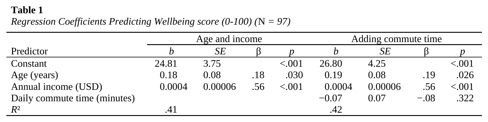

```{r}
#| label: obx-setup
#| include: false

# ---------------------------------------------------------------------------
# CONSOLE FACSIMILES -- render scaffolding, hidden (include: false). Same
# mechanism as anova.qmd: pane_facsimile.R defines the capture-once /
# display-twice helpers in their own dot-named environment (.obx). Each block
# below is one call whose code STRING is both printed into the page and
# executed once, so the shown code and the run code cannot drift. An
# unexpected error in any block HALTS the render (the publish gate).
#
# Devices, by the OUTPUT-REGISTER rule: the prose READS the output of every
# block, so the panes render OPEN (.obx$show_console(fence = TRUE)).
#
# PUBLICATION TABLES, PAGE 4 (S422 review, new: "how to place more than 1
# analysis into the same table", Jeff). It uses page 1's regression, m1;
# block 1 makes it again, so the page and its script also work in a fresh
# session. Two jlm() models of one outcome, named in the list, side by side.
#
# jstats is NOT pre-loaded: block 1 teaches library(jstats), and R prints the
# startup message on first attach only. joutput()/joptions() are left alone.
# The page WRITES one Word file into the working directory; the clean-slate
# line below removes it before the blocks run, and the teardown after.
#
# HOW-TO LAYOUT (S344). No top boxes: the shared material lives once on
# howtos.qmd, and this page points there.
# ---------------------------------------------------------------------------

options(width = 80)   # match a default 80-column console for table alignment
options(jstats.attach.noninteractive = TRUE)   # let block 1 show the real startup message

.sr_files <- c("Models.docx")
.sr_clean <- function() {
  f <- .sr_files[file.exists(.sr_files)]
  if (length(f)) file.remove(f)
  invisible(NULL)
}
.sr_clean()

source("pane_facsimile.R")   # defines .obx (dot-named); turns the output color on
```

## Several results in one table

**Publication tables &middot; Page 4**\
*It uses the regression saved on
[1. Saving results](tables-saving-results.qmd), `m1`.*

Each table on page 3 held one result. Some tables hold several, and the most
common is a set of regression models side by side, each adding predictors to
the one before. `jtable()` makes that table from a list of saved models.

Block 1 repeats the step from page 1 that saved the regression, so this page
works in a fresh session too. If `m1` is still listed in your **Environment**
pane, running block 1 again does no harm.

This page follows the pattern of every How-To: numbered blocks that build one
script, with the finished script to download at the bottom.
[Using the How-To pages](howtos.qmd#using-the-how-to-pages) explains the
pattern, and how to reset your session if something goes wrong.

### 1. Load jstats and the saved regression

```{r}
#| echo: false
#| results: asis
.obx$show_console(r"---(## ---- 1. Load jstats and the saved regression --------------------------

## Load jstats and community, make community the default data frame, and
## save page 1's regression again as m1. quiet = TRUE skips jload()'s
## report, which page 1 shows; overwrite = TRUE replaces a copy loaded
## earlier without asking first
library(jstats)
jload("community", overwrite = TRUE, quiet = TRUE)
juse(community)
m1 <- jlm(WellbeingScore ~ Age + Income, print = FALSE))---", fence = TRUE,
  lead = "The command lines are shown; the standalone <code>##</code> comment lines aren't -- running a comment just echoes it back and does nothing.")
```

jstats and `community` are loaded, `community` is the default data frame, and
`m1` is saved again, with nothing printed.

### 2. A second model

The second model adds daily commute time to the first. It is saved as `m2`,
again without printing.

```{r}
#| echo: false
#| results: asis
.obx$show_console(r"---(## ---- 2. A second model ------------------------------------------------

## The first model's predictors, and daily commute time
m2 <- jlm(WellbeingScore ~ Age + Income + CommuteTime, print = FALSE))---", fence = TRUE)
```

### 3. Two models in one table

Given a list of models, `jtable()` sets them side by side in one table. Each
name in the list heads its model's columns.

```{r}
#| echo: false
#| results: asis
.obx$show_console(r"---(## ---- 3. Two models in one table ---------------------------------------

## list() is base R: it puts the two models together, each under the name
## that will head its columns. jtable() sets them side by side in one
## table, and writes it to a Word file
t3 <- jtable(list("Age and income" = m1, "Adding commute time" = m2),
             file = "Models.docx", open = TRUE)

## Optional: the table in the Console as well
print(t3)  # base R)---", fence = TRUE)
```

```{r}
#| label: model-n
#| include: false
# The N the reading box quotes: respondents with all four variables (gated).
.sr_n <- sum(stats::complete.cases(data.frame(
  lapply(community[c("WellbeingScore", "Age", "Income", "CommuteTime")],
         function(x) ifelse(is.na(x), NA, 1)))))
```

The two models sit side by side, in the order of the list, each with its own
*b*, *SE*, *&beta;* and *p*, and its own *R*^2^ at the foot. Commute time is in
the second model only, so its row is empty under the first. The table is wide,
so `jtable()` puts it on a landscape page of its own, and its report says so.

{width=700px fig-alt="A regression table in Word in the apa style with two models side by side, headed 'Age and income' and 'Adding commute time', each with columns b, SE, beta and p; rows for the constant, age, annual income and daily commute time, and R squared under them."}

::: {.callout-note collapse="true" title="Reading this output"}
- **The headings** are the names given in the list. Left unnamed, as in
  `list(m1, m2)`, the models are headed Model 1, Model 2, and so on.
- **N = `r .sr_n`** in the title is the number of respondents in both models.
  When a variable that one model adds has missing values, the models' Ns
  differ: the title then holds no N, an N row and the table's note give each
  model's, and `jtable()` says so, with a line that fits every model on the
  same respondents.
- **Which results can share a table.** Models with the same outcome, from
  `jlm()` or from `jlogistic()`, sit side by side; `jdesc()` results stack
  into one table. Results that can't share one, such as models of different
  outcomes, stop with a message that gives the lines to make a table of each
  and write them to one file, as page 3 does.
:::

::: {.callout-tip collapse="true" title="Coming from SPSS, Stata, or SAS?"}
In **SPSS**, entering predictors in blocks (Next, in the Linear Regression
dialog) gives one Coefficients table with the models one under the other.
`jtable()` sets them side by side, each model's columns under its name.

In **Stata** 17 and later, `etable` builds a table of several estimation results
side by side.
:::

```{r}
#| label: prose-gates
#| include: false

# ---------------------------------------------------------------------------
# PROSE GATES -- hidden. Each stopifnot() below is one statement the prose
# makes about what the package does; a false one HALTS the render, the same
# publish gate the blocks have. Numbers the prose quotes are built here.
# ---------------------------------------------------------------------------
.msgs <- function(expr) {         # what a call prints, both streams, as one string
  m <- character(0)
  o <- withCallingHandlers(utils::capture.output(expr),
                           message = function(c) { m <<- c(m, conditionMessage(c))
                                                   invokeRestart("muffleMessage") })
  paste(c(o, m), collapse = "\n")
}
.pr <- function(x) utils::capture.output(print(x))
.td <- tempfile("sr-"); dir.create(.td)

# block 1 and 2: nothing printed
.q12 <- .msgs({ jlm(WellbeingScore ~ Age + Income, print = FALSE)
                jlm(WellbeingScore ~ Age + Income + CommuteTime, print = FALSE) })
# block 3: the report, the headings, the empty row
.m3 <- .msgs(jtable(list("Age and income" = m1, "Adding commute time" = m2),
                    file = file.path(.td, "M.docx")))
.pv <- .pr(t3)
.ct <- .pv[grepl("^Daily commute time", .pv)]
.num <- function(x) length(regmatches(x, gregexpr("-?[.0-9]*[0-9]", x))[[1]])
# the reading box: unnamed models are Model 1 and Model 2; Ns that differ
.pv_un <- .pr(jtable(list(m1, m2), print = FALSE))
.m_diff <- .msgs(jtable(list(m1, jlm(WellbeingScore ~ Age, print = FALSE))))
.pv_diff <- .pr(jtable(list(m1, jlm(WellbeingScore ~ Age, print = FALSE)), print = FALSE))
.flat <- function(x) gsub("\\s+", " ", x)   # a stop's message is width-wrapped
.m_out <- tryCatch({ jtable(list(m1, jlm(Income ~ Age, print = FALSE))); "" },
                   error = function(e) .flat(conditionMessage(e)))
.m_kind <- tryCatch({ jtable(list(m1, jdesc(Age, print = FALSE))); "" },
                    error = function(e) .flat(conditionMessage(e)))
.sr_lab <- attr(community$CommuteTime, "label")
# the reading box: jlogistic() models of one outcome share a table; jdesc()
# results stack into one
.lg <- tryCatch(.pr(jtable(list(jlogistic(Volunteer ~ Age, print = FALSE),
                                jlogistic(Volunteer ~ Age + Income, print = FALSE)),
                           print = FALSE)), error = function(e) character(0))
.dk <- tryCatch(.pr(jtable(list(jdesc(Age, print = FALSE), jdesc(Income, print = FALSE)),
                           print = FALSE)), error = function(e) character(0))

stopifnot(
  !nzchar(.q12),
  file.exists("Models.docx"),
  grepl("2 models side by side, on a landscape page.", .m3, fixed = TRUE),
  grepl("Table written to", .m3, fixed = TRUE),
  any(grepl("Age and income", .pv, fixed = TRUE)),
  any(grepl("Adding commute time", .pv, fixed = TRUE)),
  regexpr("Age and income", paste(.pv, collapse = "\n"), fixed = TRUE) <
    regexpr("Adding commute time", paste(.pv, collapse = "\n"), fixed = TRUE),
  identical(.sr_lab, "Daily commute time (minutes)"),
  length(.ct) == 1L, .num(sub("^Daily commute time \\(minutes\\)", "", .ct)) == 4L,
  any(grepl(paste0("(N = ", .sr_n, ")"), .pv, fixed = TRUE)),
  any(grepl("Model 1", .pv_un, fixed = TRUE)), any(grepl("Model 2", .pv_un, fixed = TRUE)),
  grepl("different numbers of cases", .m_diff, fixed = TRUE),
  grepl("jcomplete(", .m_diff, fixed = TRUE),
  !any(grepl("(N = ", .pv_diff, fixed = TRUE)), any(grepl("^N ", .pv_diff)),
  any(grepl("^Note\\. N differs by model", .pv_diff)),
  grepl("cannot share a table", .m_out, fixed = TRUE),
  grepl("cannot share a table", .m_kind, fixed = TRUE),
  any(grepl("Model 2", .lg, fixed = TRUE)),
  sum(grepl("^Table [0-9]", .dk)) == 1L, any(grepl("^Age", .dk)),
  any(grepl("^Annual income", .dk))
)
unlink(.td, recursive = TRUE)
```

## Take the whole script with you

That's the full run-through. If you'd like the entire script in one file to
keep and reuse, download it here. Put your own models in the list, named as
you want their columns headed.

The file is the finished version of the script you built: the same code, in the
same order. Its first lines say what to answer when you run it a second time
and `jtable()` asks before replacing `Models.docx`.
[Using the How-To pages](howtos.qmd#using-the-how-to-pages) says more about
finished scripts and how to run one.

<div style="margin: 1rem 0 2rem;">
<a href="tables-several-results-follow-along.R" download class="btn btn-primary">Download the full script (.R)</a>
</div>

```{r}
#| label: obx-teardown
#| include: false
# Page-end teardown: remove the file the render wrote (the setup chunk also
# clears it at render start, against a halted render).
.sr_clean()
```
